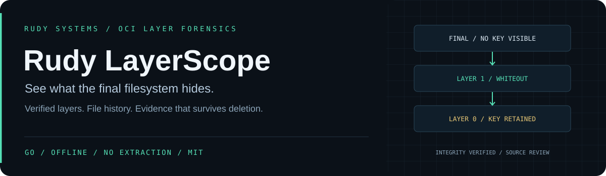

<p align="center"></p>

<p align="center">
  <a href="https://github.com/r4venrudy/rudy-layerscope/actions/workflows/ci.yml"></a>
  
  <a href="LICENSE"></a>
  <a href="https://rudy.systems"></a>
</p>

**Deleting a credential in a later container build step leaves its bytes in an earlier image layer. LayerScope makes that history reviewable.**

Rudy LayerScope is an offline Linux OCI image forensics engine written in Go. It verifies content-addressed image data, constructs a virtual filesystem, and connects findings to the exact file revisions and layers that introduced them. It needs no container daemon and never extracts or executes image payloads.

Developer preview · SHA-256 OCI layouts · uncompressed tar and gzip layers · standard library only.

### What you can investigate

| Question | Evidence |
| --- | --- |
| Was a key or credential-like file removed but left in the image? | All explicit revisions, payload digests, introducing layers, removal layers and whiteout reasons |
| What does the final filesystem contain? | Sorted virtual entries, owners, modes, link metadata and content origins |
| Were the image bytes altered or mislabeled? | Manifest/config/blob sizes and SHA-256, complete uncompressed DiffIDs and ordered ChainIDs |
| What changed between releases? | Added, removed and modified filesystem entries; introduced and removed rule fingerprints |
| Can a build use this as a gate? | JSON/SARIF output, severity gates, distinct failure exit codes |
| Can someone review the result locally? | Self-contained HTML investigation with a filterable revision timeline |

Whiteouts are staged before additions, so they affect lower layers regardless of archive order. Opaque directories hide lower children. Hardlinks retain the content of their earlier regular-file target when its original path is subsequently replaced. File bodies and environment values are omitted from reports.

### Install

Download the archive for your OS/architecture from [Releases](https://github.com/r4venrudy/rudy-layerscope/releases). Verify its hash against `SHA256SUMS`, extract it, and run `layerscope version` (`.\layerscope.exe version` on Windows).

Native release packages include the CLI, documentation, two synthetic OCI layouts and an HTML investigation. Linux amd64, Windows amd64 and macOS arm64 are packaged and smoke-tested on their native runners. The analyzed image platform is independent of the host platform.

Build from source with **Go 1.27+**:

```sh
git clone https://github.com/r4venrudy/rudy-layerscope.git
cd rudy-layerscope
go build -trimpath -buildvcs=false -o layerscope ./cmd/layerscope
go test ./...
go vet ./...
```

Or install the tagged command:

```sh
go install github.com/r4venrudy/rudy-layerscope/cmd/layerscope@v0.1.0-preview
```

On Windows, build with `-o layerscope.exe`. No external Go modules or native libraries are required.

### Try an investigation in one minute

```sh
layerscope demo example-images
layerscope scan example-images/leaky
layerscope history --path app/.env example-images/leaky
layerscope scan --format html --output investigation.html example-images/leaky
layerscope diff --format json example-images/leaky example-images/clean
```

The demo is synthetic: the private-key-shaped content is deliberately invalid, and the service/helper files are text, not executable programs. The leaky image produces six findings: a removed private-key header, two credential-like paths, a privileged file mode, root as default user, and a credential-like environment key. The clean fixture produces none of these configured findings.

```text
LS001 error   layer=0 path="root/.ssh/id_ed25519" hidden=true
  Private-key header appears in an image layer ...
  This revision is hidden from the final filesystem but its bytes remain ...
LS002 warning layer=0 path="app/.env" hidden=true
```

`demo` requires a new destination directory. All command options precede positional paths. Reports use exclusive creation and never overwrite an existing file.

### Use your own image

Provide a **local OCI image layout directory**, not a Docker daemon image name, Docker `save` archive, or unpacked root filesystem. For example, if you already use Skopeo, an explicitly requested registry copy can prepare an OCI layout:

```sh
skopeo copy docker://YOUR_REGISTRY/YOUR_IMAGE:TAG oci:local-image:review
layerscope scan --ref review --platform linux/amd64 local-image
```

The external copy contacts the registry; LayerScope itself has no network client. Analyze a stable copy of the layout on a normal local filesystem. Do not point it at concurrently modified directories or hostile mount trees.

```sh
layerscope scan --format sarif --fail-on error --output image.sarif local-image
layerscope scan --format json --max-expanded-mib 2048 --max-entries 100000 local-image
layerscope diff --fail-on finding previous-image candidate-image
```

| Exit | Meaning |
| --- | --- |
| `0` | Complete report, configured gate passed |
| `1` | Complete report, configured finding/change gate failed |
| `2` | Invalid, ambiguous, unsupported, incomplete or over-budget input; no report |
| `3` | Output/demo creation failed |

`scan --fail-on` accepts `none`, `warning` (warnings and errors), or `error`. `diff --fail-on` accepts `none`, `change` (filesystem changes), or `finding` (new rule fingerprints). Default is `none`.

### Model and boundaries

```text
OCI index → selected manifest → verified config + layer blobs
                                  ↓
              streamed tar/gzip + SHA-256 + PEM header checks
                                  ↓
        whiteout pass → virtual filesystem → revision provenance
                                  ↓
                rules / history / release comparison
                                  ↓
                  text · JSON · SARIF · local HTML
```

Supported: Linux OCI image manifests, nested indexes, top-level reference selection, exact platform selection, SHA-256 descriptors, tar/gzip layers, regular files/directories/symlinks, earlier regular-file hardlink targets, device/FIFO metadata and capability-xattr presence.

Explicit failures: zstd/encrypted layers, non-Linux images, sparse entries, duplicate normalized tar paths, forward/non-regular hardlink targets, entries traversing symlink ancestors, corrupt digests, ambiguous selection, malformed JSON, and budget exhaustion. Symlinks are recorded, never followed inside the image model. Unrelated artifact descriptors in indexes are skipped.

This is a forensics preview, not a complete OCI runtime or vulnerability database. A digest match verifies integrity against local descriptors, **not publisher identity or signatures**. Credential paths and PEM headers are review indicators; they can be synthetic or harmless. Reports do not prove exploitability, actual privileges or absence of secrets. Named users, ACLs, runtime mounts, overrides, signatures, referrers and arbitrary xattrs are not evaluated. Report paths and metadata can themselves be sensitive.

Read the [input and filesystem contract](docs/CONTRACT.md), [rule catalog](docs/RULES.md), and [security policy](SECURITY.md) before using gates in a production pipeline.

### Validation and packaging

The test suite exercises whiteout ordering, opaque directories, replacements, hardlink provenance, redaction, HTML escaping, integrity tampering, nested/multi-platform selection, limits, malformed input, CLI gates and overwrite protection. Linux CI adds the race detector and bounded fuzz smoke tests. Every OS packages and smoke-tests the exact native binary placed in its release archive.

```sh
go test -race ./...                         # supported native race toolchain required
go test -run='^$' -fuzz=FuzzLayer -fuzztime=30s -parallel=2 .
go run scripts/package.go --out artifacts/release
```

Packaging uses fixed ZIP timestamps, sorted members, `CGO_ENABLED=0`, `-trimpath` and `-buildvcs=false`. Identical source, Go toolchain and target produce identical package bytes; pin the toolchain when reproducing a release. Each package has a SHA-256 receipt; release publication combines and verifies them into `SHA256SUMS`.

---

[Rudy Systems](https://rudy.systems) · [Release notes](docs/RELEASE_NOTES.md) · [Contributing](CONTRIBUTING.md) · MIT
